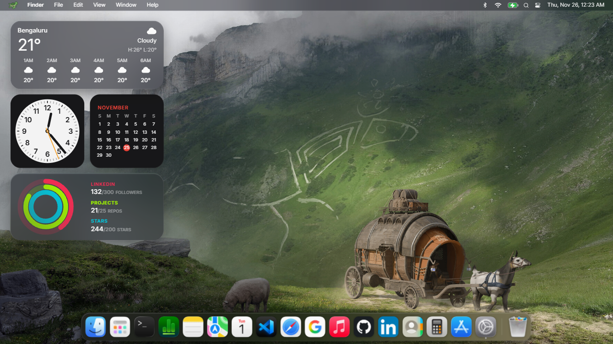
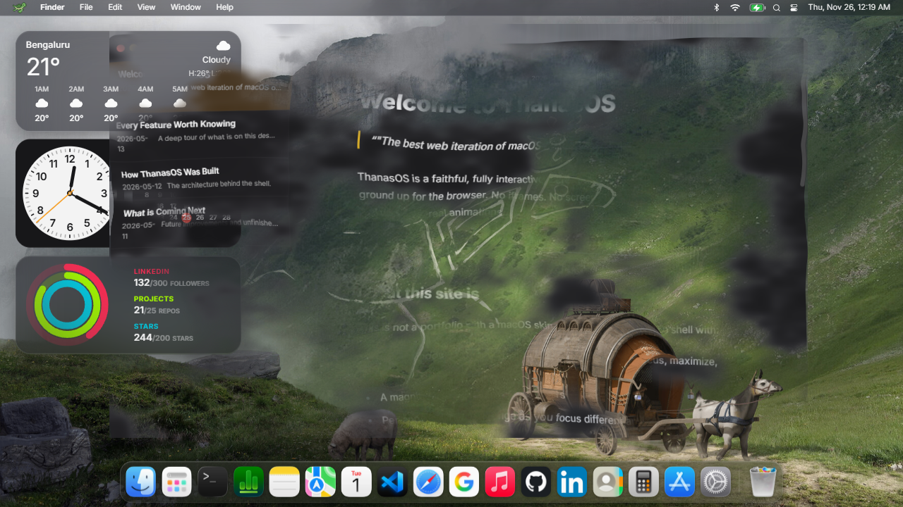
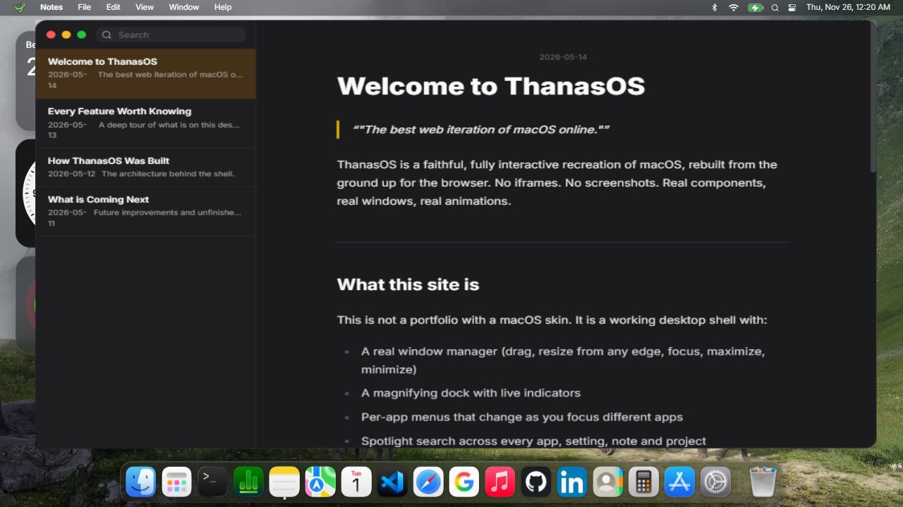

# HTML-in-Canvas Desktop Mode

ThanasOS can render the **entire desktop** (wallpaper, widgets, menu bar, windows, dock)
as one WebGPU texture, captured from real DOM through
[HTML-in-Canvas](https://github.com/WICG/html-in-canvas) (`canvas[content="drawable"]`).
Window actions then get the same effect vocabulary as
`Macos-Genie-Effect-With-WebGPU`: smoke dissolve on close, funnel collapse into the
dock on minimize, and an overshoot wobble on maximize/restore.



It is **opt-in**: Settings → Displays → *HTML-in-Canvas*. Default is off, and the
browser-support check falls back to plain DOM without ever blanking the page.

| Close (red) | Minimize (yellow) | Maximize (green) |
| --- | --- | --- |
|  |  |  |

## Architecture (minimal surface area)

```
src/canvas-os/
├── HTMLInCanvasSurface.tsx   React wrapper: off = plain children, on = canvas + Surface
├── surface.ts                WebGPU device, capture, render, effect scheduler
├── Surface.wgsl              pass-through + smoke / genie / wobble fragment shaders
├── html-in-canvas.ts         minimal wrapper for the 3 generations of the capture API
├── effect-bus.ts             window action → effect event (no prop drilling)
└── webgpu.d.ts               minimal WebGPU ambient types (no new dependency)
```

Integration touches six existing files:

| File | Change |
| --- | --- |
| `types/macos.ts` | `htmlInCanvas?: boolean` |
| `contexts/MacOSContext.tsx` | 3 one-line `triggerWindowEffect(...)` calls before state updates |
| `components/macos/Desktop.tsx` | wrap the desktop root in `<HTMLInCanvasSurface>` |
| `components/macos/Window.tsx` | `data-window-id` (effect rect lookup) |
| `components/macos/Dock.tsx` | `data-dock-app` (genie target rect) |
| `components/apps/SettingsApp.tsx` | one `<Row>` + `<Switch>` in Displays |
| `index.css` | 4 small rules for the canvas surface and hidden effect window |

No context API changes, no new dependencies, no build config changes.

## How it works

1. The desktop root becomes the direct child of `<canvas content="drawable" drawable>`.
2. Every paint, `drawElementImageToTexture` copies that subtree into `liveTex`.
3. A full-screen quad samples `liveTex` 1:1 (premultiplied alpha).
4. On close/minimize/maximize the context emits an effect **before** the state update.
   The surface captures the current DOM into `snapTex` (the frame that is about to
   disappear), then draws an effect quad for that window rect on top of the live desktop.
5. Effect quads share one instanced draw call: up to 3 effects × 4 vec4 in the uniform
   buffer (from rect, to rect, kind/progress/seed/duration, genie dir+perp).
6. The minimize effect is a line-for-line port of `Genie.fragment.wgsl`: rows are
   projected onto `(dir, perp)`, the band shrinks toward the dock icon, and each row's
   side margins follow `mix(mix(fromP, toP, slide), fromP, easeInOutQuad(t))`.
   Content is **compressed** into the shrinking band, never cropped.

### Dock stays above every effect

The dock is part of the captured desktop, so an effect quad would otherwise paint over
it. After the effect pass the renderer re-draws the **docked region** from the live
texture with a scissor rectangle (`data-dock-root`); no extra pipeline, uniform or
texture is needed. Dock magnification therefore stays visible above smoke and genie.

DOM stays fully interactive and accessible: hit-testing follows the original layout,
so drag, resize, inputs and dock magnification keep working.

## Six traps that cost the most time

1. **The captured element must be a direct child of the canvas and carry `drawable`.**
   `drawElementImageToTexture` rejects anything else with
   `Only drawable descendants of the <canvas> element can be passed...`.
   A wrapper div around the desktop breaks it.
2. **`position: fixed` children get zero geometry inside a drawable canvas.**
   The desktop root is `fixed inset-0`; inside the canvas it measured 0×0, so the
   capture was empty and the canvas rendered black. Force it with
   `.hic-canvas > [drawable] { position:absolute; inset:0; width:100%; height:100% }`.
3. **Only direct-children of the canvas are drawn**; nested wrappers are not "drawable".
4. **`@interpolate(flat)` on the position varying** makes the whole quad collapse to
   one pixel's value — everything gets discarded. Only pass rects/info as flat;
   the per-pixel CSS position must interpolate normally.
5. **Snapshot sampling needs the window sub-rect**, not 0..1:
   `snapUv = (rect.xy + localUv * rect.zw) / cssSize`. Using `localUv` directly
   stretches the whole desktop into the window rectangle (visible as duplicated widgets).

6. **Drawable children do not take pointer events until their geometry is registered.**
   Without `canvas.updateElementGeometry(content, { canvasTransform: new DOMMatrix() })`
   every click lands on the canvas: `elementFromPoint` returns `CANVAS` and the whole
   desktop is dead. Call it once after mount and again after every resize.

Also: shaders must use `textureSampleLevel(..., 0.0)` after a discard/branch
(`textureSample` is restricted to uniform control flow), and `from`/`to` are
reserved words in WGSL.

## Scope and limits

- Effects only run for the **top-most** window (checked in `triggerWindowEffect`).
  Effect quads are composited above the live desktop, so animating a background window
  would incorrectly cover the windows above it.
- Smoke/genie/wobble read from a snapshot taken at the moment of the action; the DOM
  window is hidden (wobble) or already removed (close/minimize) during the animation.
- The rest of the desktop is captured live, so dock magnification, drag/resize and
  widget animations appear unchanged.
- Toggling the switch mounts/unmounts the canvas, so the desktop subtree remounts:
  open windows close and the Settings panel returns to its first section. That is the
  price of keeping the off path at zero cost.
- If `content="drawable"` or WebGPU is missing, the switch does nothing and the
  desktop renders exactly as before.
